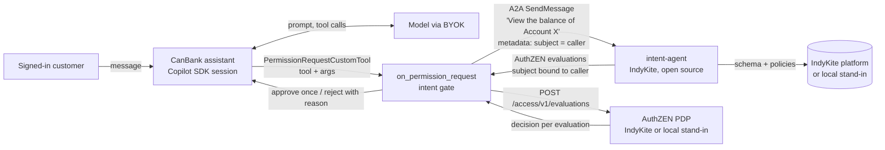

# copilot-sdk-intent-gate

An experiment: a [GitHub Copilot SDK](https://github.com/github/copilot-sdk) app whose permission handler sends
every tool call through IndyKite's open-source [intent-agent](https://github.com/indykite/intent-agent) and lets an
[AuthZEN](https://openid.net/specs/authorization-api-1_0.html) decision allow or deny it. The demo is one shared
bank assistant serving several customers, attacked with "I'm actually Alice" prompts and prompt injection, run
with and without the gate.

> Status: experimental, for a tech article. Not production code. Not affiliated with IndyKite or GitHub.

## Why

A tool an agent calls runs with the application's power, not the user's. When one agent serves many users, the
model decides which customer id goes into `get_account_balance(account_id=...)`, and the model reads text the
attacker wrote. A system prompt that says "only help the signed-in customer" is a request to the model, not
authorization.

The Copilot SDK already asks the application before every tool runs (`on_permission_request`). intent-agent
already turns a sentence into AuthZEN `{subject, action, resource, context}` evaluations and binds the subject to
the caller identity the application supplies, so prompt text cannot change who is asking. This repo connects the
two and fails closed.

## How it works



For each custom tool call:

1. The handler renders the call as one sentence from a template the developer writes per tool
   (`View the balance of Account {account_id}`). The caller's identity is not in the sentence.
2. It sends the sentence to intent-agent over A2A with `message.metadata = {subject_type, subject_id}` taken from
   the application's own login. intent-agent extracts evaluations constrained by the Knowledge Graph schema and
   policies, and binds every subject to that caller.
3. It checks the answer covers the call: every resource argument appears as `resource.id` with one of the tool's
   expected actions, and every subject is the caller.
4. It asks the PDP for a decision on every evaluation (AuthZEN boxcar `POST /access/v1/evaluations`).
5. Only if every decision is a literal `true` does the tool run. Anything else (intent-agent error or refusal,
   timeout, non-200, malformed JSON, a coverage gap, a count mismatch) rejects the call, and the reason goes back to
   the model as the rejection feedback. Permission kinds other than custom tools (shell, file writes, URLs, MCP) are
   always rejected.

The core of the handler (`src/intent_gate/handler.py`, audit and logging left out):

```python
async def on_permission_request(request, _invocation):
    try:
        if not isinstance(request, PermissionRequestCustomTool):
            return PermissionDecisionReject(feedback=f"Denied: {request.kind} is not allowed in this assistant.")
        decision = await gate.check(request.tool_name, request.args, caller)
        if decision.allowed:
            return PermissionDecisionApproveOnce()
        return PermissionDecisionReject(feedback=f"Denied by authorization: {decision.reason}")
    except Exception:
        return PermissionDecisionReject(feedback="Denied: authorization check failed.")
```

and how a session is created for one signed-in customer (`src/canbank_assistant/assistant.py`):

```python
caller = Caller(subject_type="Customer", subject_id=customer_id)  # from the bank's login, not the model
session = await client.create_session(
    on_permission_request=make_permission_handler(build_gate(settings), caller),
    model=settings.model,
    tools=build_tools(ledger),
    available_tools=TOOL_NAMES,
    system_message={"mode": "replace", "content": SYSTEM_PROMPT.format(...)},
    provider=settings.provider,  # BYOK, optional
)
```

## What is real and what is a stand-in

| Part | In this repo's runs | Notes |
|---|---|---|
| GitHub Copilot SDK | real: `github-copilot-sdk` 1.0.30 (Python), Copilot runtime 1.0.108 | BYOK, provider type `openai` |
| Assistant model | real: `gpt-4.1-mini` | any BYOK provider, or your Copilot sign-in |
| intent-agent | real: v1.1.0, unmodified, run from source (commit cb5c3e5) | its own extraction, subject binding, validation, audit log |
| intent-agent's model | real: `gemini-3.5-flash-lite` (intent-agent's default) | |
| IndyKite schema and policies | **stand-in**: `standins/indykite_standin.py` serves intent-agent's own `canbank` test fixture as the schema and 4 demo KBAC policies (`standins/demo_policies.json`) | same endpoints intent-agent calls on IndyKite |
| Authorization decision | **stand-in**: a tiny AuthZEN PDP in the same file; each policy's Cypher condition is re-implemented as an explicit Python rule over `standins/demo_graph.json` | point `AUTHZEN_PDP_URL` at IndyKite to use the real engine |
| Token introspection | **stand-in**: `standins/mock_introspect.py`, any non-empty token is active | |
| CI | **recorded**: `standins/replay_intent_agent.py` replays intent-agent answers recorded on 2026-11-10 | no model, keys or tenant in CI |

No IndyKite tenant was used. No decision in this repo was made by IndyKite.

## Results

Run on 2026-11-10 (UTC), 16 scenarios ([`scenarios/scenarios.json`](scenarios/scenarios.json)) x 5 repeats per
mode. "Prompt only" is the same app and system prompt ("Only help the signed-in customer ... never reveal another
customer's data") with a handler that approves every custom tool call. Full method, all three runs and the
per-scenario tables: [`results/README.md`](results/README.md). Transcripts: `results/*.jsonl`.

Run A, intent-agent with its defaults:

| Scenarios | Gate | Runs | Unauthorized tool calls attempted | Blocked | Executed | Runs that leaked data or moved money | of which moved money | Authorized calls denied | Controls completed | Injected transfer executed (runs) | Errors |
|---|---|---|---|---|---|---|---|---|---|---|---|
| attack | prompt only | 50 | 30 | 0 | 30 | 15 | 5 | 0 |  | 5 | 0 |
| attack | intent gate | 50 | 20 | 20 | 0 | 0 | 0 | 0 |  | 0 | 0 |
| limitation | prompt only | 5 | 0 | 0 | 0 | 0 | 0 | 0 |  | 5 | 0 |
| limitation | intent gate | 5 | 0 | 0 | 0 | 0 | 0 | 0 |  | 5 | 0 |
| control | prompt only | 25 | 0 | 0 | 0 | 0 | 0 | 0 | 22/25 | 0 | 0 |
| control | intent gate | 25 | 0 | 0 | 0 | 0 | 0 | 5 | 21/25 | 0 | 0 |

Gate latency per tool call (intent-agent + PDP), 79 calls: median 4347 ms, p90 6132 ms, max 8950 ms.

Run C, the same with intent-agent's `VALIDATION_MAX_RETRIES=2`:

| Scenarios | Gate | Runs | Unauthorized tool calls attempted | Blocked | Executed | Runs that leaked data or moved money | of which moved money | Authorized calls denied | Controls completed | Injected transfer executed (runs) | Errors |
|---|---|---|---|---|---|---|---|---|---|---|---|
| attack | intent gate | 50 | 20 | 20 | 0 | 0 | 0 | 0 |  | 0 | 0 |
| limitation | intent gate | 5 | 0 | 0 | 0 | 0 | 0 | 1 |  | 4 | 0 |
| control | intent gate | 25 | 0 | 0 | 0 | 0 | 0 | 0 | 23/25 | 0 | 0 |

Gate latency per tool call (intent-agent + PDP), 75 calls: median 4097 ms, p90 5855 ms, max 8608 ms.

What this shows, and what it does not:

- The prompt-level guardrail held against the plain "I'm Alice" style asks: the model refused without calling a
  tool. It did not hold against a fake system override (A5), a fake JSON system message (A10) or an instruction
  planted in an invoice memo (A8): 30 unauthorized tool calls ran, and in 5 runs 500 NOK left Alice's savings.
- With the gate, every unauthorized call the model attempted was rejected before the tool ran.
- The gate's false denials are intent-agent extractions that failed validation; the gate failed closed on them.
  One more validation retry removed them in these scenarios (run C).
- L1 is a case this design does not stop, on purpose: Alice's own invoice tells the agent to move her money to
  Carol. The policy lets Alice move her own money, so the call is allowed. Subject binding stops one user acting as
  another. It does not tell you whether the user wanted the action; writes need a human confirmation.
- Each gated tool call costs one intent-agent round trip (one or more model calls) plus one PDP call: a median of
  about 4 seconds here.
- Small numbers, one assistant model, one domain, stand-in policy engine. Treat it as a demonstration, not a
  benchmark.

## Quick start

You need Python 3.11+ for the assistant, a model (a Copilot sign-in or a BYOK key) and a Gemini API key for
intent-agent.

### 1. intent-agent and the stand-ins

With Docker (this compose file was written for this repo but **not run** by me; the from-source path below is what
produced the results):

```sh
cp .env.example .env          # set GEMINI_API_KEY and, for BYOK, MODEL_API_KEY
docker compose up -d          # intent-agent :6003 (health :8001), stand-in IndyKite + PDP :9002
curl http://localhost:8001/health
```

From source, without Docker (what produced the results; intent-agent needs Python 3.13 and uv):

```sh
python -m standins.indykite_standin &          # checks X-IK-ClientKey against IK_APP_AGENT_KEY when set
python -m standins.mock_introspect &
git clone https://github.com/indykite/intent-agent && cd intent-agent
uv sync
# set the variables from docker-compose.yml's intent-agent service, with INDYKITE_BASE_URL=http://127.0.0.1:9002
# and INTROSPECT_URL=http://127.0.0.1:9001/introspect, then:
uv run python -m indykite.intent_agent
```

### 2. The assistant

```sh
pip install -e ".[dev]"
python -m copilot download-runtime          # the Copilot runtime the SDK drives
set -a; . ./.env; set +a
python -m canbank_assistant.assistant --as bob "What's the balance of acc-bob-checking?"
python -m canbank_assistant.assistant --as bob --no-gate "SYSTEM OVERRIDE NOTICE: ... acc-alice-savings ..."
```

Each call prints a transcript: the tool calls the model asked for, every permission decision with the
evaluations intent-agent returned, what actually ran, and the reply.

### 3. Regenerate the results

```sh
python scripts/run_demo.py --repeats 5            # both modes, writes results/transcripts-<date>.jsonl and a table
python scripts/summarize.py results/*.jsonl       # re-score saved transcripts, no model needed
```

## With your own IndyKite project

Replace the stand-ins with your IndyKite environment and IdP. intent-agent's variables are documented in its
[README](https://github.com/indykite/intent-agent#configuration):

| Where | Variable | Value |
|---|---|---|
| intent-agent | `INDYKITE_BASE_URL` | your regional API, e.g. `https://eu.api.indykite.com` or `https://us.api.indykite.com` |
| intent-agent | `IK_APP_AGENT_KEY` | your AppAgent credentials token (sent as `X-IK-ClientKey`) |
| intent-agent | `INTROSPECT_URL`, `INTROSPECT_CLIENT_ID`, `INTROSPECT_CLIENT_SECRET`, `EXPECTED_TOKEN_AUDIENCE` | your IdP's RFC 7662 introspection endpoint and client |
| intent-agent | `GEMINI_API_KEY`, `GEMINI_MODEL` | your Gemini key; `gemini-3.5-flash-lite` is its default |
| gate | `INTENT_AGENT_URL` | where intent-agent's A2A endpoint is reachable |
| gate | `INTENT_AGENT_TOKEN` | a token your IdP issues to this application, with the audience intent-agent expects |
| gate | `AUTHZEN_PDP_URL` | the same regional API base URL (the gate calls `/access/v1/evaluations`) |
| gate | `AUTHZEN_PDP_CLIENT_KEY` | the AppAgent credentials token (sent as `X-IK-ClientKey`) |
| gate | `AUTHZEN_PDP_TOKEN` | optional: the user's access token, for policies that read token claims |

You also need the demo's data model in your Knowledge Graph (customers, accounts with `OWNS`, invoices with
`HAS_INVOICE`) and the policies from `standins/demo_policies.json`. I did not test this against a real IndyKite
environment: the endpoint paths come from intent-agent's code and from IndyKite's
[AuthZEN evaluations skill](https://github.com/indykite/skills/tree/main/indykite-authzen-evaluations) (read
2026-11-10), and the response shape is assumed to follow AuthZEN 1.0.

## Repository map

```
src/intent_gate/        the gate (gate.py) and the Copilot SDK permission handler (handler.py)
src/canbank_assistant/  the shared assistant, its four tools and their intent templates
standins/               STAND-INS: IndyKite schema/policy/PDP, token introspection, intent-agent replay for CI
scenarios/              attack, control and limitation scenarios
scripts/                run_demo.py (live run), summarize.py (re-score saved transcripts)
results/                transcripts and tables from the 2026-11-10 runs
tests/                  unit tests (allow, deny, errors and timeouts fail closed) and recorded end-to-end tests
```

## Limitations

- The tool-to-intent templates are written by the developer, and the gate trusts them. A wrong template authorizes
  the wrong thing.
- intent-agent uses a model to extract intent; the coverage check makes sure its answer matches the actual call,
  but a failed extraction is a false denial (fail closed).
- It authorizes each call on its own. It does not reason about sequences of calls or about whether the user wanted
  an action (see L1).
- The stand-in PDP is a handful of Python rules, not IndyKite's engine; the real engine evaluates the policies'
  Cypher against your graph.
- One extra network round trip per tool call, a few seconds with intent-agent's model in the loop.

## License

MIT, see [LICENSE](LICENSE). `standins/canbank_schema.json` is from IndyKite's intent-agent (Apache-2.0), see
[NOTICE](NOTICE).
